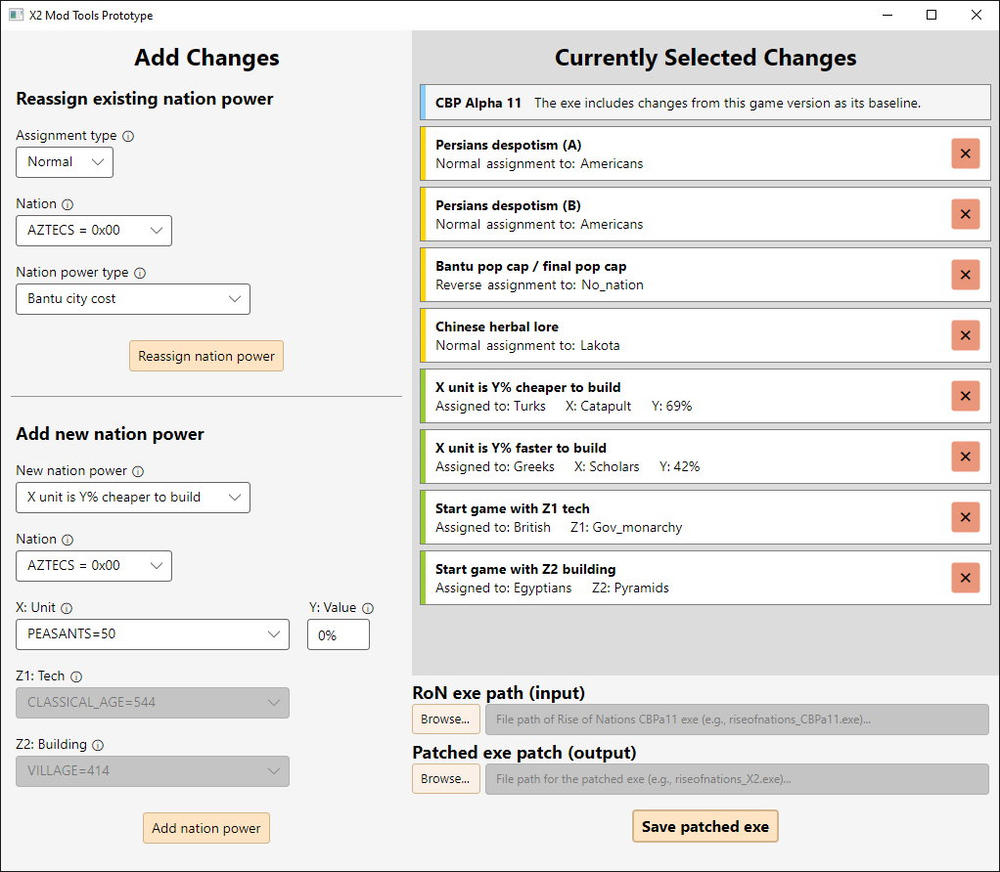

# X2 Mod Tools Prototype (x2-prototype)

A prototype Avalonia app that provides a GUI to change "hardcoded" aspects of Rise of Nations like nation powers. It reads in a copy of the RoN game exe, makes "hardcoded" changes in memory as controlled by the GUI, and then saves a copy of the exe with these changes applied. The original exe is not affected.

Around 2022 I went through and figured out how to reassign hardcoded nation powers between nations, provided others with a CLI tool to do this, and experimented with 1vX games where one player (human or AI) "stole" other player's nation powers (spoiler: that player always stomped everyone else). I hesitantly worked towards a more polished GUI implementation after this under the name "X2". In 2024 almost all of my uncompleted work was invalidated when the June 2024 patch for RoN:EE was released, and I largely abandoned the idea of redoing all the work, particularly with CBP monopolizing my modding time.

This prototype represents a glimpse of what I had envisioned making back in 2022. I would like it to act as a reminder that it is entirely possible to accomplish significant technical modding of RoN without violent usage of LLMs, and that people saying that changing these things was impossible are being incredibly small-minded.

_I think "X2" was originally supposed to refer to the "eXtended Edition" being "eXtended" further._

## Limitations

Because of its prototype nature, this implementation comes with several time-saving limitations compared to some theoretical "full scope" version:

- No changes to e.g., maximum number of nations.
- Only nation powers are affected (no changes to rares, wonders, etc).
- Nation power reassignment is only available for **C**hinese, **B**antu, and **P**ersians nation powers.
- Only five types of "new" nation powers can be added:
  - X unit is Y% cheaper to build (max 100%).
  - X unit is Y% faster to build (max 100%).
  - Start game with X unit.
  - Start game with Z1 tech. _(note: this mangles some assembly instructions and then restores them later)_
  - Start game with Z2 building. _(note: this mangles some assembly instructions and then restores them later)_
- New nation powers can't be "reverse" assigned.
- UI is half-baked; game-internal names are used for units/buildings/techs).
- Much of the code is whatever the opposite of robust is and the current design will not scale well if extended significantly.
- Probably has undiscovered bugs, though I did start several dozen patched games while testing.
- The input exe exclusively accepts CBPa11 because it was easier for me, even though this program completely undermines game balance.
  - As a consequence, it relies on CBPa11 game files and outputs an exe with the CBP icon, strings, etc.

## Usage

Reassign existing nation powers using the controls in the top-left quadrant. Reverse-assignments invert who the nation power is given to, so everyone _except_ the specified nation get the chosen power. Add new nation powers using the controls in the bottom-left quadrant.

Reassignments and additions will be listed on the right side. This list is pre-populated with several example changes, though you by no means have to keep these examples. You can remove entries from the list using the red "X" on the right side of the entry. Lists and dropdowns have their own scrollbars which should become visible as necessary.

Reassigned nation powers rely on the same rules.xml entries that they originally did (for those that originally did). New nation powers do not interact with the rules.xml file.

At some point before saving the patched exe, you'll need to use the first "Browse..." button to provide a path to a compatible RoN game exe - at time of writing, the exe name will likely be named `riseofnations_CBP.exe`, but will likely to be `riseofnations_CBPa11.exe` when a new version of CBP comes out. Supplying this path to the program will automatically create a path for the output exe, though you can optionally change this path using the second "Browse..." button.

Once you're ready, use the "Save patched exe" button to save a patched copy of the exe to disk. This exe will need to be in the same folder that the RoN game exe normally is to run.

## Version compatibility

This software explicitly targets a Rise of Nations: Extended Edition v00.2024.06.2000 game exe with Alpha 11 of the [Community Balance/Bugfix Patch](https://steamcommunity.com/sharedfiles/filedetails/?id=2287791153) applied, with or without the LAA ("4GB patch") flag set.

## Download

Download the latest release [here](https://github.com/MHLoppy/x2-prototype/releases/tag/latest).

X2 Mod Tools Prototype targets 64-bit Windows systems and requires .NET 8 or higher to run. If not already installed, you may be prompted to install .NET when first running the software.

## Credits

- `Relocations.cs` has been boosted nearly wholesale from [Relocation Section Editor](https://github.com/MHLoppy/Relocation-Section-Editor), originally published by [Christophe Mohimont (mohic)](https://github.com/mohic/Relocation-Section-Editor) and credited to gta126 (whether these are the same person is not explicitly clear).
- I would likely never have completed this work without the early influence of resources from [Nand to Tetris](https://www.nand2tetris.org/), [247CTF](https://www.youtube.com/channel/UCtGLeKomT06x3xZ2SZp2l9Q), and [jeFF0Falltrades](https://www.youtube.com/channel/UCdfLhhh6fD5d4MAysukz-uw) while I was starting out. In a time where the average quality of educational materials seems to be declining (HMM wonder why??? MYSTERY), high quality resources that are freely accessible continue to be memorably valuable.

## License

As per above, `Relocations.cs` is not covered under the below licenses as it's almost entirely not my work and cannot legally be re-licensed as it was not originally published with one.

Excluding that file and its contents, this software is dual-licensed:

- For any current or former natural persons, use the Death and Repudiation License.
- For any entities not covered by the above, use the Monkey License.